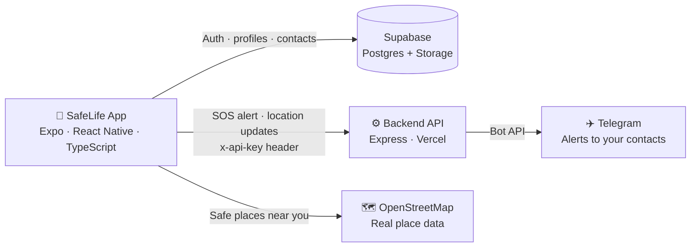
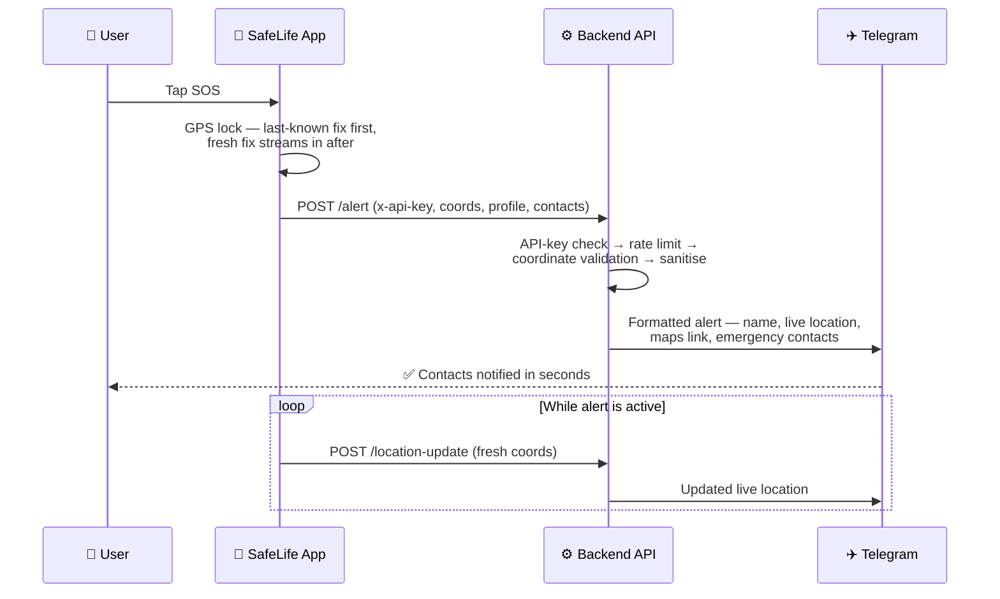

<div align="center">


<br/>


**SafeLife is a personal-safety app that turns a single tap into a full emergency alert — your live location, your name, and your emergency contacts, delivered to your people in seconds.**

[📱 Download the Android APK](https://github.com/r1shabhsharma05/Saftey-App/releases) · [🌐 Web App](https://safelife-ai.vercel.app) · [⚙️ Backend Status](https://safelife-backend-rish0000-dots-projects.vercel.app/health)

</div>

---

## 📖 About

Emergencies don't wait for you to unlock your phone, open a chat, type a message, and share your location. **SafeLife removes every one of those steps.**

Tap **SOS** and SafeLife instantly:
1. Locks onto your GPS location (last-known fix first, so the alert is never blocked waiting for a signal)
2. Packages your name, live coordinates, a maps link, and your saved emergency contacts
3. Fires it through a hardened backend straight to your contacts on **Telegram** — in seconds, even on a weak connection

Around that core, SafeLife is a complete safety companion: Supabase-powered accounts with profile photos, a contacts manager that pulls straight from your phone book, live location updates while an alert is active, and a **Safe Hub** that shows genuinely safe places near you using real OpenStreetMap data — **no mock data, anywhere**.

The app ships with a premium dark UI (glass cards, glow accents, Manrope + Space Grotesk typography), runs on Android, iOS and Web from one TypeScript codebase, and is backed by a security-hardened Express API with rate limiting, API-key authentication, strict input validation, and CORS locked to the app's own origins.

---

## ✨ Features

| | Feature | What it does |
|---|---|---|
| 🆘 | **One-Tap SOS** | A single tap sends an emergency alert with your live GPS location — the app never blocks the alert while waiting for a perfect GPS fix |
| 📍 | **Live Location Updates** | While an alert is active, your position keeps updating so contacts can follow you in real time |
| 👥 | **Emergency Contacts** | Pick contacts directly from your phone book (`expo-contacts`), save them to your profile, and they're automatically listed in every SOS alert |
| 🗺️ | **Safe Hub** | Nearby police stations and safe places from **real OpenStreetMap data** — live, not placeholders |
| 👤 | **Profiles & Avatars** | Supabase Auth accounts with profile photos (image picker → Supabase Storage avatars bucket, protected by row-level security) |
| 🔐 | **Secure by Default** | API-key authenticated endpoints, per-IP rate limits, Helmet headers, coordinate validation, control-character sanitisation |
| 🎨 | **Premium UI** | Dark glassmorphism design, animated glow buttons, tilt cards, haptic feedback, custom Manrope / Space Grotesk type |
| 🔋 | **Battery-Aware** | Battery state is monitored during alerts, so an SOS flow knows if the phone is about to die |
| 📱 | **Cross-Platform** | Android APK, iOS and a static web build — one Expo codebase |

---

## 🏗️ Architecture



**Two halves, one repo:**

- **`mobile-app/`** — the Expo / React Native app (file-based routing with `expo-router`, Supabase for auth + data, native modules for location, contacts, camera/photos, battery and haptics)
- **`Backend/`** — a small, hardened Express API whose only job is to receive an alert and fan it out reliably (Telegram today; SMS via httpSMS is wired behind an API-key gate)

---

## 🔄 How an SOS Works — The Full Workflow



**Step by step:**

1. **Tap** — The SOS button fires immediately. If GPS permission is missing or a fresh fix is slow, the app falls back to the last-known / cached coordinates instead of failing silently — an alert with slightly old coordinates always beats no alert.
2. **Package** — The app builds the payload: user name, latitude/longitude, accuracy, timestamp, and the user's saved emergency contacts (up to 10 are listed in the message).
3. **Authenticate & protect** — Every alert call carries an `x-api-key` header. The backend checks it, enforces a per-IP rate limit (10 alerts/minute), validates coordinates strictly (range + type), and strips control characters from all strings.
4. **Deliver** — The backend formats and sends the alert to the configured Telegram chats via the Bot API. Delivery does not depend on the app staying open.
5. **Track** — While the alert is live, the app keeps posting location updates, so the people who got your SOS can follow your movement.

---

## 🛠️ Tech Stack & Packages

### 📱 Mobile App (`mobile-app/`)

| Package | Version | Purpose |
|---|---|---|
| `expo` | ~54.0.33 | Expo SDK 54 — the app runtime & build toolchain |
| `react-native` | 0.81.5 | Cross-platform native UI |
| `react` | 19.1.0 | UI library |
| `typescript` | ~5.9.2 | Type safety across the whole app |
| `expo-router` | ~6.0.23 | File-based navigation (tabs, auth, onboarding) |
| `@supabase/supabase-js` | ^2.101.1 | Auth, Postgres data and Storage (avatars) |
| `expo-location` | ~19.0.8 | GPS — SOS coordinates & live tracking |
| `expo-contacts` | ~15.0.11 | Phone-book access for emergency contacts |
| `expo-image-picker` | ~17.0.11 | Profile photo selection |
| `expo-image` | ~3.0.11 | Fast, cached image rendering |
| `expo-battery` | ~10.0.8 | Battery awareness during active alerts |
| `expo-haptics` | ~15.0.8 | Tactile feedback on critical actions |
| `react-native-reanimated` | ~4.1.1 | Fluid UI animations |
| `react-native-gesture-handler` | ~2.28.0 | Gesture handling |
| `expo-blur` · `expo-linear-gradient` | ~15.0.8 | Glass UI & gradient surfaces |
| `@expo-google-fonts/manrope` · `@expo-google-fonts/space-grotesk` | ^0.4.x | Typography |
| `@react-native-async-storage/async-storage` | ^2.2.0 | Local persistence (cached coords, session) |

### ⚙️ Backend (`Backend/`)

| Package | Version | Purpose |
|---|---|---|
| `express` | ^4.18.2 | HTTP API framework |
| `helmet` | ^8.3.0 | Security response headers |
| `express-rate-limit` | ^8.7.1 | Per-IP rate limiting on alert endpoints |
| `cors` | ^2.8.6 | CORS locked to the app's origins |
| `axios` | ^1.14.0 | Telegram Bot API delivery |

### ☁️ Platform

| Service | Role |
|---|---|
| **Supabase** (ap-south-1) | Postgres database, Auth, Storage — `profiles` & `emergency_contacts` tables with row-level security |
| **Vercel** | Backend hosting + web app hosting |
| **Telegram Bot API** | Instant alert delivery to emergency contacts |
| **OpenStreetMap** | Real safe-place data for the Safe Hub |
| **GitHub Actions** | Android APK builds (cloud — see below) |

---

## 📁 Project Structure

```
Saftey-App/
├── Backend/                  # Express API (deployed on Vercel)
│   ├── server.js             # API entry — /alert, /location-update, /test-alert, /health
│   ├── api/index.js          # Vercel serverless entry
│   ├── lib/validate.js       # Coordinate validation & input sanitisation
│   ├── middleware/           # CORS policy · rate limiters · API-key auth
│   ├── Dockerfile            # Container build for self-hosting
│   └── .env.example          # Backend environment template
│
├── mobile-app/               # Expo / React Native app
│   ├── app/                  # Screens (expo-router)
│   │   ├── (tabs)/           # Home (SOS) · Explore · Contacts
│   │   ├── login.tsx · register.tsx · verify-email.tsx
│   │   └── onboarding.tsx
│   ├── components/           # UI kit — GlassCard, GlowButton, TiltCard, SafeHubCard…
│   │   └── auth/             # Auth screen building blocks
│   ├── constants/            # Theme & design tokens
│   ├── hooks/                # Colour-scheme & shared hooks
│   ├── utils/                # Supabase client · backend URL · auth helpers · escape logic
│   ├── eas.json              # EAS build profiles (preview = APK)
│   └── .env.example          # Mobile environment template
│
├── .github/workflows/
│   └── build-apk.yml         # Cloud Android APK build → GitHub Release
├── DEPLOYMENT_CHECKLIST.md
├── PRODUCTION_UPGRADE_GUIDE.md
└── package.json              # Root scripts — run backend + app together
```

---

## 🚀 Getting Started

### Prerequisites

- **Node.js 18+** and npm
- **Expo Go** on your phone (or an Android emulator) for development
- A free **Supabase** project (database + auth + storage)
- A **Telegram bot** (2 minutes with [@BotFather](https://t.me/BotFather)) for alert delivery

### 1 · Clone

```bash
git clone https://github.com/r1shabhsharma05/Saftey-App.git
cd Saftey-App
```

### 2 · Backend

```bash
cd Backend
cp .env.example .env        # fill in the values below
npm install
npm start                   # http://localhost:5000  →  GET /health
```

### 3 · Mobile app

```bash
cd mobile-app
cp .env.example .env        # fill in the values below
npm install
npx expo start              # scan the QR with Expo Go
```

> **Run both at once** from the repo root: `npm run dev` (uses `concurrently`).

### 🔑 Environment variables

**Backend (`Backend/.env`)**

| Variable | What it is |
|---|---|
| `TELEGRAM_BOT_TOKEN` | Bot token from @BotFather |
| `TELEGRAM_CHAT_IDS` | Comma-separated Telegram chat IDs that receive SOS alerts |
| `API_SECRET` | Shared secret — the app must send the same value as the `x-api-key` header |
| `PORT` | Local dev port (default `5000`; ignored on Vercel) |

**Mobile (`mobile-app/.env`)**

| Variable | What it is |
|---|---|
| `EXPO_PUBLIC_SUPABASE_URL` | Your Supabase project URL |
| `EXPO_PUBLIC_SUPABASE_ANON_KEY` | Supabase anon (public) key |
| `EXPO_PUBLIC_BACKEND_URL` | Backend base URL — **https only** in production builds |
| `EXPO_PUBLIC_API_SECRET` | Must match the backend's `API_SECRET` |

Generate a strong secret with:
```bash
node -e "console.log(require('crypto').randomBytes(32).toString('hex'))"
```

---

## 📡 API Reference

Base URL (production): `https://safelife-backend-rish0000-dots-projects.vercel.app`

| Method | Endpoint | Auth | Rate limit | Description |
|---|---|---|---|---|
| `GET` | `/` | — | — | Service status page |
| `GET` | `/health` | — | — | Health check (status, uptime, integrations) |
| `POST` | `/alert` | `x-api-key` | 10 / min / IP | Send an SOS alert with live location + contacts |
| `POST` | `/location-update` | `x-api-key` | tracking limiter | Stream fresh coordinates during an active alert |
| `POST` | `/test-alert` | `x-api-key` | 5 / min / IP | Send a test alert to verify your setup |

**Example — fire an SOS:**

```bash
curl -X POST https://safelife-backend-rish0000-dots-projects.vercel.app/alert \
  -H "Content-Type: application/json" \
  -H "x-api-key: YOUR_API_SECRET" \
  -d '{
    "name": "Rishabh",
    "latitude": 28.5355,
    "longitude": 77.3910,
    "contacts": [{ "name": "Mom", "phone": "+91…" }]
  }'
```

Invalid coordinates are rejected with `400`; a missing/invalid API key with `401`; breaching a rate limit with `429`.

---

## 🔒 Security

SafeLife handles the most sensitive data a phone has — where you are, and who protects you. The backend is hardened accordingly:

- **API-key authentication** on every mutating endpoint (`requireApiKey` middleware)
- **Rate limiting** per IP on all alert routes — no alert-spam floods
- **Helmet** security headers on every response
- **Strict input validation** — coordinates are type- and range-checked; all strings sanitised (control characters stripped); request bodies capped at 32 KB
- **CORS locked down** to the app's own origins, with a security-headers layer and HTTPS-only production URLs
- **Row-Level Security** on Supabase — users can only ever read/write their own profile, contacts and avatar
- **Secret hygiene** — tokens and keys live only in environment variables; `.env` files are git-ignored, and `.env.example` templates ship with placeholders

---

## 📦 Building the Android APK

APKs are built **in the cloud on GitHub Actions** (no local Android SDK needed):

1. Push to the `apk-build` branch — **or** open the repo's **Actions** tab → **Build SafeLife APK** → **Run workflow**
2. The workflow installs dependencies, runs a Gradle release build, and publishes the APK to a **GitHub Release** (`apk-N`)
3. Download the `.apk` from the release and install it — builds are signed with a consistent keystore, so new versions install cleanly as updates

An **EAS Build** fallback is also configured (`mobile-app/eas.json`, `preview` profile → APK, package `com.rishabh.safelifeai`).

---

## 🌐 Deployment

| Piece | Where | URL |
|---|---|---|
| Backend API | Vercel | https://safelife-backend-rish0000-dots-projects.vercel.app |
| Web app | Vercel | https://safelife-ai.vercel.app |
| Database / Auth / Storage | Supabase (Mumbai, ap-south-1) | — |
| Android app | GitHub Releases | [Latest APK](https://github.com/r1shabhsharma05/Saftey-App/releases) |

Self-hosting the backend instead? A `Dockerfile` ships in `Backend/` — `docker build` it, set the env vars, done.

---

## 🗺️ Roadmap

- [ ] 📩 True SMS alerts via httpSMS (backend path wired; pending API key)
- [ ] 🎨 New app logo & brand refresh
- [ ] 🔔 Push notifications for alert acknowledgements
- [ ] 🧪 Automated test coverage for the alert pipeline

---

## 🤝 Contributing

Issues and PRs are welcome. If you're changing the alert flow, please test against `POST /test-alert` first and never commit real secrets — use the `.env.example` templates.

---

<div align="center">

### 👨‍💻 Built by Rishabh Sharma

[](https://github.com/r1shabhsharma05)
[](https://www.linkedin.com/in/rishabh-sharma-342575438/)

*Because in an emergency, every second — and every step — counts.*


</div>
