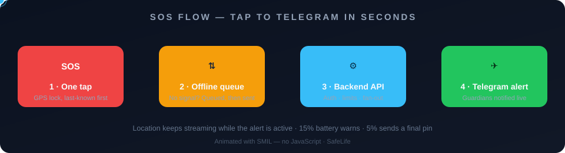
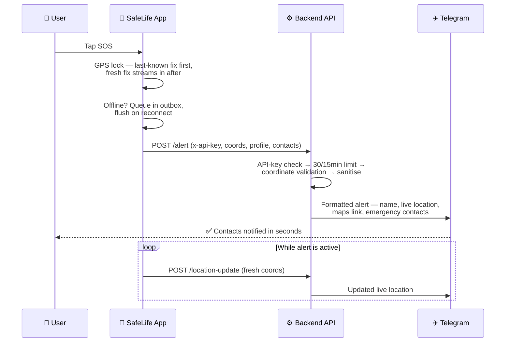

# SafeLife — Personal Safety, One Tap Away

<div align="center">


**One tap sends an emergency alert — your live location, your name, and your emergency
contacts — to the people who protect you, in seconds. Even offline. Even on a dying phone.**

[🌐 Web App](https://safelife-ai.vercel.app) · [⚙️ Backend Health](https://safelife-backend-rish0000-dots-projects.vercel.app/health) · [🚀 Landing Page](https://landing-rosy-delta-55.vercel.app)



</div>

---

## About

SafeLife is a personal-safety app built by [Rishabh Sharma](https://github.com/r1shabhsharma05). One tap sends an emergency alert — your live location, your name, and your emergency contacts — to the people who protect you, in seconds. Even offline. Even on a dying phone. It runs on Android, iOS and Web from one TypeScript codebase, backed by a security-hardened Express API.

🚀 **Landing page:** https://landing-rosy-delta-55.vercel.app
🌐 **Live web app:** https://safelife-ai.vercel.app
⚙️ **Backend:** https://safelife-backend-rish0000-dots-projects.vercel.app

---

## 📖 Overview

Emergencies don't wait for you to unlock your phone, open a chat, type a message, and
share your location. **SafeLife removes every one of those steps.**

Tap **SOS** and SafeLife:

1. Locks onto your GPS location — last-known fix first, so the alert is never blocked
   waiting for a signal
2. Packages your name, live coordinates, a maps link, and your saved emergency contacts
3. Sends it through a hardened backend straight to your contacts on **Telegram** — in
   seconds, even on a weak connection
4. Keeps streaming your live location while the alert is active, so your contacts can
   follow you in real time

Around that core, SafeLife is a complete safety companion: Google sign-in, a contacts
manager that pulls straight from your phone book, a **Safe Hub** of genuinely safe places
near you from real OpenStreetMap data, and a **SafeRoute** walking route to the nearest
safe place — with ETA, drawn in the app. No mock data, anywhere.

The app runs on Android, iOS and Web from one TypeScript codebase, with a premium dark
UI (glass cards, glow accents, Manrope + Space Grotesk typography), backed by a
security-hardened Express API with rate limiting, API-key authentication, strict input
validation, and CORS locked to the app's own origins.

---

## ✅ Key Features — Verified Numbers Only

Every number below was verified live against this repo (see
[Current Status](#-current-status--whats-live-and-what-isnt) for the proof trail).

| | Feature | What it does |
|---|---|---|
| 🆘 | **One-Tap SOS** | A single tap sends an emergency alert with live GPS — never blocked waiting for a perfect fix. **Confirmed working by the user on 2026-10-23.** |
| 📴 | **Offline SOS Queue** | No signal? The alert is queued in the app outbox and sent automatically when connectivity returns — with backoff and a delivery-status UI. |
| 📍 | **Live Tracking** | While an alert is active, fresh coordinates keep streaming to the alert's live page, so contacts follow your movement. |
| 👥 | **Emergency Contacts** | Pick contacts from your phone book (`expo-contacts`); they're listed in every SOS alert. |
| 🗺️ | **Safe Hub** | Nearby police stations and safe places from **real OpenStreetMap/Overpass data** — police within 20 km, everything else within 10 km, 200-result cap. |
| 🚶 | **SafeRoute** | In-app walking route to the nearest-best safe place with distance + ETA. Live probe 2026-11-06: `200`, **1,629 m / 1,303 s / 69 polyline points**. 25 km abuse cap, 30/min limiter. |
| 🔋 | **Low-Battery Alerts** | **15%** pre-alert ("not an SOS") while discharging; **5%** final location burst while an alert is active; re-arms above 20%. Unknown readings never fire. |
| 🔐 | **Google Sign-In** | Native OAuth sign-in via Supabase Auth (PKCE exchange). |
| 👤 | **Profiles & Avatars** | Supabase Auth accounts with profile photos — Storage avatars bucket, owner-only row-level security. |
| 🧪 | **Tested Backend** | **162/162 backend tests passing, 0 fail** — verified live 2026-11-06 on `main` (`93db487`), Node 24. |
| 🔒 | **Secure by Default** | API-key auth, per-IP rate limits, Helmet headers, coordinate validation, control-character sanitisation, 32 KB body cap. |

---

## 🚀 SafeLife 2.0 — What Shipped (30-Day Program)

SafeLife is being rebuilt in a 30-day program (Day 1 = 2026-10-24, Day 30 = **2026-11-22** —
release APK + phone test). Days 1–14 are done; every day ships one unit end-to-end with
tests, then pushes.

| Day | Date | What shipped | Commit |
|---|---|---|---|
| 1 | Oct 24 | Backend services/routes restructure, route guards, audit logging | `588fc31` |
| 2 | Oct 25 | Upstash Redis + QStash wiring, SOS limiter migration | `ea82733` |
| 3 | Oct 26 | SOS alert lifecycle + Postgres schema + audit log | `f48f1d4` |
| 4 | Oct 27 | Delivery engine — channel adapters, receipts, QStash retries | `31b8755` |
| 5 | Oct 28 | Offline outbox hardening — net-state flush, backoff, delivery-status UI | `a53ceec` |
| 6 | Oct 29 | Phase test — SOS simulation suite (offline, retry, server-kill, rate-limit) | `e85300e` |
| 7 | Oct 30 | SMS channel adapter (httpSMS) + per-contact fan-out | `7a2774c` |
| 8 | Oct 31 | WhatsApp Business Cloud API adapter + per-contact fan-out | `0682b78` |
| 9 | Nov 1 | FCM push channel + contacts-side live alert page | `1a42331` |
| 10 | Nov 2 | Escalation ladder + ACK tracking + Bolna voice step | `6e495ab` |
| 11 | Nov 3 | Low-battery pre-alert (15%) + final location burst (5%) — **133/133 tests** | `a4240d0` |
| 12 | Nov 4 | Phase 2 chaos test — all four channels end-to-end, one disabled | `97a87cc` |
| 13 | Nov 5 | Upstash safe-places cache tier + open-now filter + scoring annotations — **154/154 tests** | `32a183b` |
| 14 | Nov 6 | OSRM walking-route proxy + in-app route map to nearest-best safe place — **162/162 tests** | `93db487` |
| **30** | **Nov 22** | **Release APK + phone test + API-secret activation** | — |

Days 15–29 continue the plan (safety scoring, journey live-tracking, hardening), then one
final release APK — **no interim APKs**.

---

## 🛠️ Tech Stack

Verified from the repo's own `package.json` files — nothing listed here isn't in the code.

### 📱 Mobile App (`mobile-app/`)

| Package | Version | Purpose |
|---|---|---|
| `expo` | ~54.0.33 | Expo SDK 54 — app runtime & build toolchain |
| `react-native` | 0.81.5 | Cross-platform native UI |
| `react` | 19.1.0 | UI library |
| `typescript` | ~5.9.2 | Type safety across the whole app |
| `expo-router` | ~6.0.23 | File-based navigation (tabs, auth, onboarding) |
| `@supabase/supabase-js` | ^2.101.1 | Auth, Postgres data, Storage (avatars) |
| `expo-location` | ~19.0.8 | GPS — SOS coordinates & live tracking |
| `expo-contacts` | ~15.0.11 | Phone-book access for emergency contacts |
| `expo-battery` | ~10.0.8 | Battery awareness — 15% / 5% alerts |
| `expo-image-picker` | ~17.0.11 | Profile photo selection |
| `expo-image` | ~3.0.11 | Fast, cached image rendering |
| `expo-haptics` | ~15.0.8 | Tactile feedback on critical actions |
| `react-native-reanimated` | ~4.1.1 | Fluid UI animations |
| `react-native-gesture-handler` | ~2.28.0 | Gesture handling |
| `expo-blur` · `expo-linear-gradient` | ~15.0.8 | Glass UI & gradient surfaces |
| `@expo-google-fonts/manrope` · `@expo-google-fonts/space-grotesk` | ^0.4.x | Typography |
| `@react-native-async-storage/async-storage` | ^2.2.0 | Local persistence (outbox, cached coords, session) |

### ⚙️ Backend (`Backend/`)

| Package | Version | Purpose |
|---|---|---|
| `express` | ^4.18.2 | HTTP API framework |
| `helmet` | ^8.3.0 | Security response headers |
| `express-rate-limit` | ^8.7.1 | Per-IP rate limiting on every route |
| `cors` | ^2.8.6 | CORS locked to the app's origins |
| `axios` | ^1.14.0 | Telegram Bot API + Overpass/OSRM upstream calls |
| `node` | `24.x` | Runtime (`engines` field — Vercel runs 24.x) |

### ☁️ Platform & Services

| Service | Role | Status (live `/health`, 2026-11-06) |
|---|---|---|
| **Supabase** (ap-south-1, `xkfrsjtfbylhhrvibmxk`) | Postgres, Auth, Storage — owner-only RLS | ⚠️ Project paused 2026-11-01 — not configured |
| **Vercel** (region `bom1`) | Backend + web hosting, 30 s function cap | ✅ Serving |
| **Telegram Bot API** (`@safe_alret_bot`) | Instant alert delivery to guardians | ✅ Configured, 1 recipient |
| **Upstash Redis** | Shared SOS rate-limit bucket + safe-places cache | ⚠️ Vars unset — memory tier only |
| **QStash** | Delayed retries + escalation-ladder timers | ⚠️ Token unset — ladder not live |
| **Overpass / OpenStreetMap** | Real safe-place data | ⚠️ All 4 mirrors failing from Vercel (see below) |
| **OSRM** (project-osrm + FOSSGIS race) | Walking-route geometry | ✅ Live — probed 200 on 2026-11-06 |
| **httpSMS** | SMS channel adapter | ⚠️ Adapter shipped, API key pending |
| **WhatsApp Cloud API** | WhatsApp channel adapter | ⚠️ Adapter shipped, business verification pending |
| **Firebase FCM** | Push channel adapter | ⚠️ Adapter shipped, project setup pending |
| **Bolna** | Voice-call escalation step | ⚠️ Adapter shipped, agent + key pending |

---

## 🏗️ Architecture

```mermaid
flowchart TB
    App["📱 SafeLife App<br/>Expo · React Native · TypeScript"] -->|SOS · location · x-api-key| API["⚙️ Backend API<br/>Express · Vercel · Node 24"]
    App -->|Auth · profiles · contacts · RLS| DB[("Supabase Postgres<br/>ap-south-1 · Auth · Storage")]
    API -->|Bot API| TG["✈️ Telegram<br/>@safe_alret_bot → guardians"]
    API -->|SOS bucket · safe-places cache| UP[("Upstash Redis<br/>shared limits + cache")]
    API -->|Delayed retries · ladder timers| QS["QStash<br/>delivery retries · escalation"]
    API -->|Safe-places proxy| OSM["Overpass / OSM<br/>real place data"]
    API -->|Route proxy| OSRM["OSRM<br/>walking routes"]
    App -->|Direct fallback| OSM
    API -.->|Adapter shipped, not live| SMS["httpSMS · SMS"]
    API -.->|Adapter shipped, not live| WA["WhatsApp Cloud API"]
    API -.->|Adapter shipped, not live| FCM["Firebase FCM · Push"]
    API -.->|Adapter shipped, not live| BOL["Bolna · Voice calls"]

    classDef notlive stroke-dasharray: 5 5, color: #94A3B8;
    class SMS,WA,FCM,BOL notlive;
```

**Two halves, one repo:**

- **`mobile-app/`** — the Expo / React Native app (file-based routing with `expo-router`,
  Supabase for auth + data, native modules for location, contacts, camera/photos,
  battery and haptics). The offline outbox lives here: an SOS with no connectivity is
  queued and flushed on reconnect.
- **`Backend/`** — a small, hardened Express API whose only job is to receive an alert
  and fan it out reliably. One service per concern (`sos.js`, `delivery.js`,
  `escalation.js`, `safePlaces.js`, `route.js`, `battery.js`, `telegram.js`,
  `sms.js`, `whatsapp.js`, `push.js`, `voice.js`, `qstash.js`, `redis.js`,
  `supabaseDb.js`, `alertStore.js`, `alertLifecycle.js`, `audit.js`) behind thin
  routes — every service has tests.

---

## 🔄 How an SOS Works



**Step by step:**

1. **Tap** — The SOS button fires immediately. If GPS permission is missing or a fresh
   fix is slow, the app falls back to last-known / cached coordinates instead of failing
   silently — an alert with slightly old coordinates always beats no alert.
2. **Queue (if offline)** — With no connectivity, the alert is stored in the app outbox
   and sent automatically when the network returns, with backoff and a delivery-status UI.
3. **Package** — The app builds the payload: user name, latitude/longitude, accuracy,
   timestamp, and saved emergency contacts (up to 10 listed in the message).
4. **Authenticate & protect** — Every alert call carries an `x-api-key` header. The
   backend checks it (when `API_SECRET` is configured), enforces the SOS rate limit
   (30 alerts / 15 min / IP), validates coordinates strictly (range + type), and strips
   control characters from all strings.
5. **Deliver** — The backend formats and sends the alert to the configured Telegram chats
   via the Bot API. Delivery does not depend on the app staying open. SMS, WhatsApp,
   push and voice fan-out are wired behind the same delivery engine and activate as
   their credentials land.
6. **Track** — While the alert is live, the app keeps posting location updates, so the
   people who got your SOS can follow your movement. Two guardian ACKs stop the
   escalation ladder; un-ACKed alerts escalate on a timer (ladder live once QStash +
   Bolna are configured).
7. **Battery watch** — At 15% discharging, contacts get a plain "not an SOS" warning
   with the last location. At 5% during an active alert, they get one final pin.

**Safe-route flow:** Dashboard → nearest-best safe place (same ranking the RESCUE button
and SOS message use) → `GET /route` proxies two public OSRM hosts in a race → in-app
map draws the polyline with distance + walking ETA → "Open in Google Maps" escape hatch.
A failed fetch shows an honest error card — never a straight line pretending to be a route.

---

## 📡 API Reference

Base URL (production): `https://safelife-backend-rish0000-dots-projects.vercel.app`

| Method | Endpoint | Auth | Rate limit | Description |
|---|---|---|---|---|
| `GET` | `/` | — | — | Service status page |
| `GET` | `/health` | — | — | Health check — status, uptime, per-channel config |
| `POST` | `/alert` | `x-api-key` | 30 / 15 min / IP | Send an SOS alert with live location + contacts |
| `POST` | `/battery-alert` | `x-api-key` | 30 / 15 min / IP | Low-battery warning / final burst |
| `POST` | `/location-update` | `x-api-key` | 60 / min / IP | Stream fresh coordinates during an active alert |
| `GET` | `/alert/:id` | `x-api-key` | 60 / min / IP | Alert status for the live page |
| `POST` | `/alert/:id/ack` | signed token | 60 / min / IP | Guardian acknowledges — stops escalation |
| `POST` | `/escalate` | — | 60 / min / IP | Escalation-ladder step (QStash-driven) |
| `GET` | `/alert/:id/view` · `/alert/:id/location` | — | 60 / min / IP | Contacts-side live alert page + pin |
| `POST` | `/delivery-retry` | — | 60 / min / IP | QStash retry callback |
| `POST` | `/test-alert` | `x-api-key` | 10 / hour / IP | Send a test alert (default-deny unless `ENABLE_TEST_ALERT=1`) |
| `GET` | `/safe-places?lat&lng` | — | 30 / min / IP | Nearby safe places, ranked, with `distanceKm` + `openNow` |
| `GET` | `/route?fromLat&fromLng&toLat&toLng` | — | 30 / min / IP | Walking route — distance, duration, polyline (25 km cap) |

**Example — fire an SOS:**

```bash
curl -X POST https://safelife-backend-rish0000-dots-projects.vercel.app/alert \
  -H "Content-Type: application/json" \
  -H "x-api-key: YOUR_API_SECRET" \
  -d '{
    "name": "Rishabh",
    "latitude": 28.5355,
    "longitude": 77.3910,
    "contacts": [{ "name": "Mom", "phone": "+91…" }]
  }'
```

Invalid coordinates are rejected with `400`; a missing/invalid API key with `401`;
breaching a rate limit with `429` (JSON + `Retry-After`); an unconfigured channel with
`502` — the API fails honestly instead of pretending a message was sent.

---

## 📁 Project Structure

```
Saftey-App/
├── Backend/                  # Express API (Vercel Root Directory)
│   ├── server.js             # API entry — mounts routes, trust proxy, 32 KB body cap
│   ├── api/index.js          # Vercel serverless entry
│   ├── lib/validate.js       # Coordinate validation & input sanitisation
│   ├── middleware/           # CORS policy · rate limiters · API-key auth
│   ├── routes/               # alerts · safePlaces · route · system
│   ├── services/             # sos · delivery · escalation · safePlaces · route
│   │                         # battery · telegram · sms · whatsapp · push · voice
│   │                         # qstash · redis · supabaseDb · alertStore · audit
│   ├── tests/                # 23 test files — 162 tests, `npm test`
│   ├── Dockerfile            # Container build for self-hosting
│   └── .env.example          # Backend environment template
│
├── mobile-app/               # Expo / React Native app
│   ├── app/                  # Screens (expo-router)
│   │   ├── (tabs)/           # Home (SOS) · Explore · Contacts
│   │   ├── login.tsx · register.tsx · verify-email.tsx · reset-password.tsx
│   │   └── onboarding.tsx · auth-callback.tsx
│   ├── components/           # UI kit — GlassCard, GlowButton, TiltCard,
│   │                         # SafeHubCard, RouteMap, AlertActiveView…
│   ├── constants/            # Theme & design tokens
│   ├── hooks/ · utils/       # Supabase client · backend URL · googleAuth ·
│   │                         # batteryAlerts · routeMath · outbox helpers
│   ├── eas.json              # EAS build profiles (preview = APK)
│   └── .env.example          # Mobile environment template
│
├── supabase/migrations/      # 6 SQL migrations (RLS, SOS alerts, delivery…)
├── docs/
│   └── sos-flow-animated.svg # Animated SOS flow (SMIL, no JavaScript)
├── .github/workflows/
│   └── build-apk.yml         # Cloud Android APK build → GitHub Release
├── DEPLOYMENT_CHECKLIST.md
├── PRODUCTION_UPGRADE_GUIDE.md
└── package.json              # Root scripts — run backend + app together
```

---

## 🚀 Getting Started

### Prerequisites

- **Node.js 24** and npm (backend `engines` is `24.x`)
- **Expo Go** on your phone (or an Android emulator) for development
- A free **Supabase** project (database + auth + storage)
- A **Telegram bot** (2 minutes with [@BotFather](https://t.me/BotFather)) for alert delivery

### 1 · Clone

```bash
git clone https://github.com/r1shabhsharma05/Saftey-App.git
cd Saftey-App
```

### 2 · Backend

```bash
cd Backend
cp .env.example .env        # fill in the values below
npm ci
npm test                    # 162 tests — must be green before any change ships
npm start                   # http://localhost:5000  →  GET /health
```

### 3 · Mobile app

```bash
cd mobile-app
cp .env.example .env        # fill in the values below
npm install
npx expo start              # scan the QR with Expo Go
```

> **Run both at once** from the repo root: `npm run dev` (uses `concurrently`).

### 🔑 Environment variables

**Backend (`Backend/.env`)** — see `.env.example` for the full list with setup notes:

| Variable | What it is |
|---|---|
| `TELEGRAM_BOT_TOKEN` · `TELEGRAM_CHAT_IDS` | Bot token + comma-separated recipient chat IDs |
| `API_SECRET` | Shared secret — the app sends it as the `x-api-key` header |
| `UPSTASH_REDIS_REST_URL` · `UPSTASH_REDIS_REST_TOKEN` | Shared rate-limit bucket + safe-places cache |
| `QSTASH_TOKEN` · `PUBLIC_BASE_URL` | Delayed retries + escalation timers |
| `SUPABASE_URL` · `SUPABASE_SERVICE_ROLE_KEY` | Postgres mirror + audit (server-side only) |
| `HTTPSMS_API_KEY` · `HTTPSMS_FROM` | SMS channel (server-side only) |
| `WHATSAPP_ACCESS_TOKEN` · `WHATSAPP_PHONE_NUMBER_ID` · `WHATSAPP_TEMPLATE_NAME` | WhatsApp channel |
| `FCM_PROJECT_ID` · `FCM_CLIENT_EMAIL` · `FCM_PRIVATE_KEY` | Push channel |
| `BOLNA_API_KEY` · `BOLNA_AGENT_ID` | Voice-call escalation step |
| `CORS_ALLOWED_ORIGINS` · `ENABLE_TEST_ALERT` · `PORT` | CORS allowlist · test-alert gate · local port (default `5000`) |

**Mobile (`mobile-app/.env`)**

| Variable | What it is |
|---|---|
| `EXPO_PUBLIC_SUPABASE_URL` | Your Supabase project URL |
| `EXPO_PUBLIC_SUPABASE_ANON_KEY` | Supabase anon (public) key |
| `EXPO_PUBLIC_BACKEND_URL` | Backend base URL — **https only** in production builds |
| `EXPO_PUBLIC_API_SECRET` | Must match the backend's `API_SECRET` |

Generate a strong secret with:
```bash
node -e "console.log(require('crypto').randomBytes(32).toString('hex'))"
```

---

## 🔒 Security

SafeLife handles the most sensitive data a phone has — where you are, and who protects you.
The backend is hardened accordingly:

- **API-key authentication** on every mutating endpoint (`requireApiKey` middleware) —
  enforced whenever `API_SECRET` is set; production activation is Day 30 (see below)
- **Rate limiting** per IP on all routes — SOS 30/15 min, tracking 60/min, test 10/hour,
  safe-places + route 30/min each; 429s are JSON with `Retry-After`
- **Helmet** security headers on every response; **32 KB** body cap
- **Strict input validation** — coordinates are type- and range-checked; all strings
  sanitised (control characters stripped); route pairs over 25 km are rejected before
  any upstream call; no user-controlled hosts anywhere (no SSRF surface)
- **CORS locked down** to the app's own origins — unset allowlist means no CORS headers
  (fail closed)
- **Row-Level Security** on Supabase — users can only ever read/write their own profile,
  contacts and avatar (6 migrations in `supabase/migrations/`)
- **Secret hygiene** — tokens and keys live only in environment variables; `.env` files
  are git-ignored, and `.env.example` templates ship with placeholders
- **Honest failures** — an unconfigured channel answers `502 channel-not-configured`,
  never a fake success

---

## 📍 Current Status — What's Live and What Isn't

Checked live on **2026-11-06** (production `/health` + Vercel probes + `npm test` on `main`).
This section is deliberately honest — a safety app must not oversell itself.

**✅ Live right now**

- Backend serving on Vercel (`/health` → `status: OK`), web app returning 200
- Telegram delivery configured (1 recipient) — SOS confirmed working by the user, 2026-10-23
- `GET /route` live — probed 200 with real OSRM geometry (1,629 m / 1,303 s / 69 points)
- Backend test suite **162/162 passing** on `main`
- Google sign-in, offline outbox, live tracking, battery alerts — shipped in code, tested

**⚠️ Shipped in code, NOT live yet**

- **Escalation ladder / ACK / Bolna voice** — needs QStash vars, Bolna agent + key, and the
  D10 migration. `/health` reports `qstash: false`, `voice: false`.
- **SMS / WhatsApp / push** — adapters shipped and test-covered; keys, business
  verification and Firebase setup are still pending. `/health` reports all three `false`.
- **Supabase Postgres mirror** — project paused 2026-11-01; migrations + env vars pending.
  Until they land, alert records live in instance memory and audit stays stdout-only.
- **Upstash shared cache tier** — dormant until the Upstash vars land in Vercel; the
  in-memory cache tier is active.
- **API-key enforcement** — currently fail-open in production (`apiKeyEnforced: false`);
  activates on Day 30 with the coordinated app release.
- **Safe places, live** — `GET /safe-places` currently returns the honest
  `502 {"error": "Safe places lookup failed"}` from Vercel: all four Overpass mirrors
  are failing from Vercel (3rd day running, not a code regression — neither the query
  nor the mirrors changed). The app falls back to querying Overpass directly from the
  phone. The cache header (`X-SafePlaces-Cache`) and `distanceKm`/`openNow` annotations
  will be re-probed once the mirrors answer.
- **Low-battery alerts** — decision, send and queue logic are test-covered; no real-phone
  discharge test yet (that proof arrives unannounced, on a real discharge).
- **APK** — no interim APKs. One final release APK on **Day 30 (2026-11-22)**, phone-tested.

---

## 🗺️ Roadmap

- **Days 15–29** — Safety scoring v1, journey live-tracking, hardening, final polish
- **Day 30 (2026-11-22)** — Release APK + phone test + `API_SECRET` activation
- After release — SMS key, WhatsApp verification, Firebase push, Bolna voice, Supabase
  unpause + migrations, in that order of owner action

---

## 📦 Building the Android APK

APKs are built **in the cloud on GitHub Actions** (no local Android SDK needed):

1. Push to the `apk-build` branch — **or** open the repo's **Actions** tab →
   **Build SafeLife APK** → **Run workflow**
2. The workflow installs dependencies, runs a Gradle release build, and publishes the APK
   to a **GitHub Release**
3. Download the `.apk` from the release and install it

An **EAS Build** fallback is also configured (`mobile-app/eas.json`, `preview` profile →
APK, package `com.rishabh.safelifeai`).

---

## 🤝 Contributing

Issues and PRs are welcome. If you're changing the alert flow, please test against
`POST /test-alert` first, run `npm test` in `Backend/` (162 tests — keep them green),
and never commit real secrets — use the `.env.example` templates.

---

## 📄 License

ISC — see `package.json`.

<div align="center">

### 👨‍💻 Built by Rishabh Sharma

[](https://github.com/r1shabhsharma05)
[](https://www.linkedin.com/in/rishabh-sharma-342575438/)

*Because in an emergency, every second — and every step — counts.*

</div>
